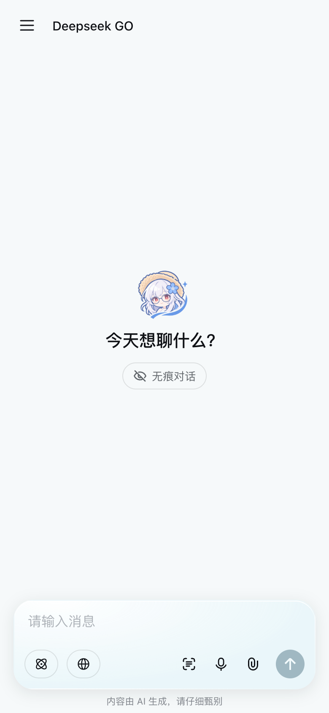
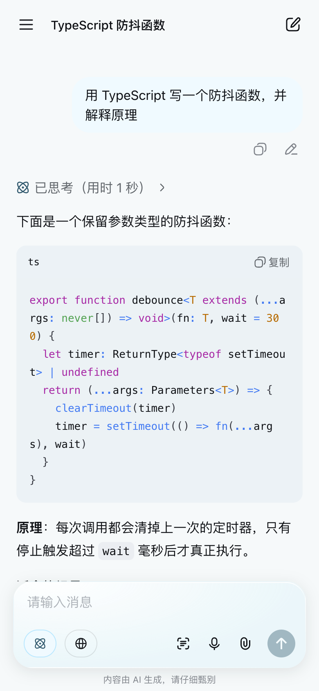
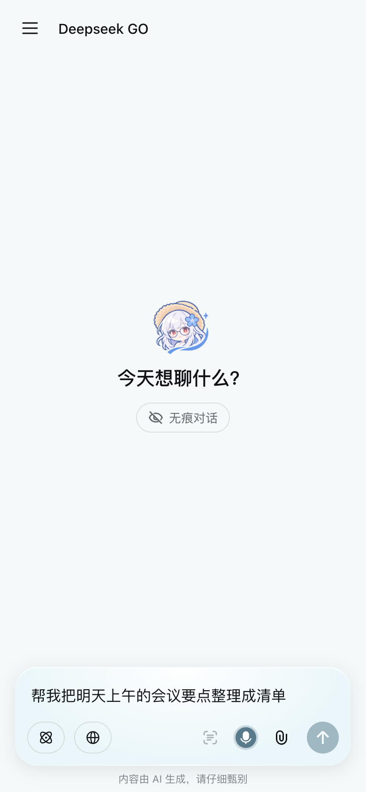
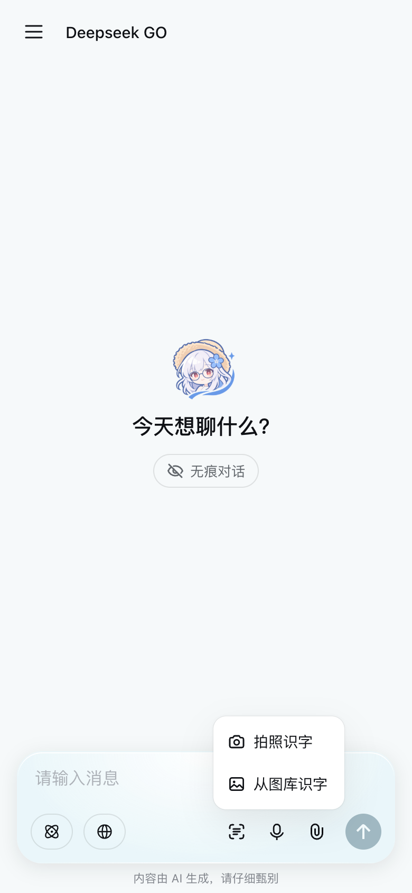
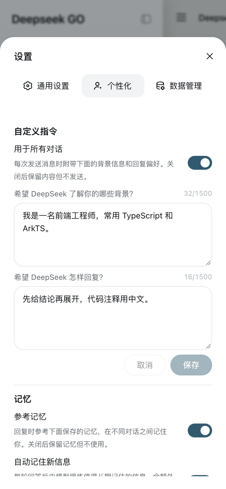
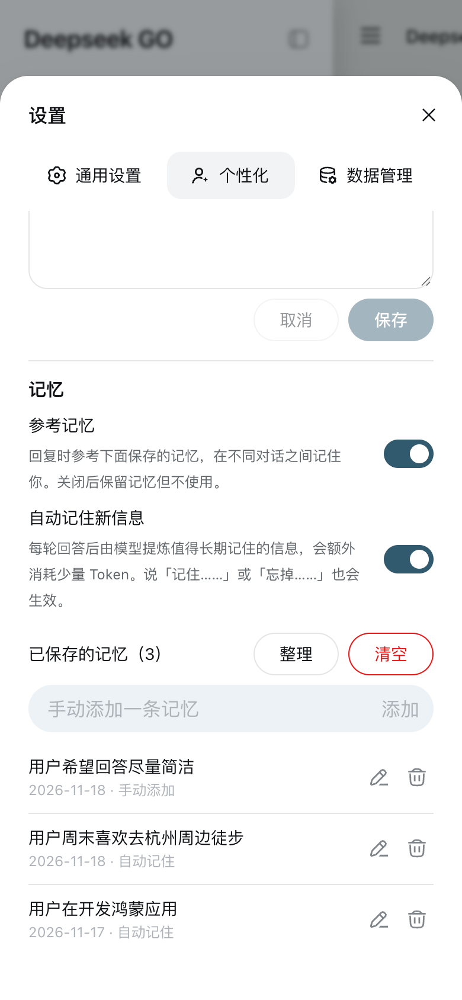
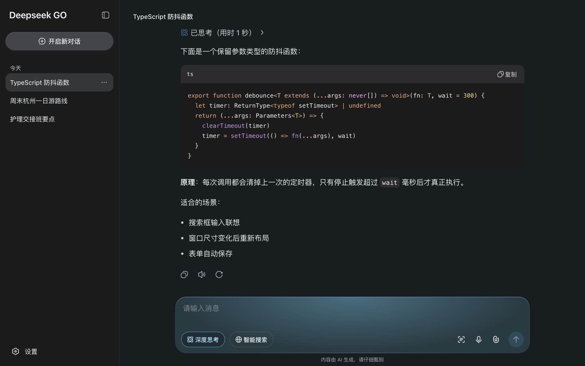

<p align="center">
  
</p>

<h1 align="center">Deepseek GO</h1>

<p align="center">A DeepSeek chat client for HarmonyOS phones, foldables, tablets, and 2-in-1 devices</p>

<p align="center">
  <a href="https://github.com/APXS114514/DeepSeekGo-Harmony/releases/latest">Download the latest release</a> ·
  <a href="CHANGELOG.md">Changelog</a> ·
  <a href="#build-from-source">Build from source</a> ·
  <a href="CONTRIBUTING.md">Contribute</a> ·
  <a href="README.md">简体中文</a>
</p>

Deepseek GO is a third-party HarmonyOS client based on DeepSeek’s official Chat Demo. It supports system voice input, image text recognition, and system sharing.

It wraps the official open-source [Chat Demo](https://github.com/deepseek-ai/chat-demo) in a native HarmonyOS app using ArkTS and ArkWeb. It keeps streaming replies, DeepThink, web search, and Markdown rendering from the web demo and adds incognito chats, reply notifications, and memory across chats.

The app connects directly to `https://api.deepseek.com`. You’ll need your own [DeepSeek API key](https://platform.deepseek.com/api_keys).

The project’s code is open source under the MIT License. APXS owns the copyright to the app icon and the original character artwork on the welcome screen. Both are licensed separately under CC BY-NC-ND 4.0, which governs their use and sharing.

## Screenshots

| Welcome screen | DeepThink and code | Voice input |
| :---: | :---: | :---: |
|  |  |  |
| **Image text recognition** | **Custom instructions** | **Memory across chats** |
|  |  |  |

**Tablet and dark mode.** On wider windows, chat history stays in the left sidebar. You can collapse it at any time.



The screenshots show only the bundled app interface.

## Features

### Chat

- Stream replies in multi-turn chats, edit earlier messages and regenerate replies, and switch between reply versions.
- **DeepThink.** Preview the latest few lines of reasoning. The preview collapses when the answer starts. Tap its heading to expand it.
- **Web search.** Search the web with source citations. In wide windows, source cards appear alongside the chat on the right.
- Render Markdown, highlighted code, equations, and Mermaid diagrams. Copy replies or read them aloud.
- Attach images, PDFs, Office documents, and code files.
- **Incognito chat.** Turn it on from the new chat screen. Incognito chats skip history and memory and are discarded when you leave.

### HarmonyOS features

- **Voice input.** System offline speech recognition shows text as you speak and adds it to the composer when you pause. Recognition runs on your device and uses no DeepSeek tokens.
- **Recognize text in an image.** Take a photo or pick one from the gallery. The app recognizes text on your device and inserts it into the composer without uploading the image.
- **Share to Deepseek GO.** Choose **Share → Deepseek GO** in another app. Text, links, images, and documents appear in a new chat for you to review before sending.
- **Export chat history.** In **Settings → Data**, export all chats as a ZIP file and choose where to save it in the system file picker. Import an archive from the same page.
- **Background generation and reply notifications.** Replies can keep generating in the background. Tap the completion notification to go straight to the chat. You can turn this off in **Settings → General → Reply notifications**.
- **Secure API key storage.** HarmonyOS Asset Store keeps the key in the device’s secure storage, outside web storage.

Voice input and image text recognition depend on the device’s system AI capabilities. The app hides the corresponding buttons on devices that lack support.

### Personalization and memory

Open **Settings → Personalization**.

- **Custom instructions.** Fill in **What should DeepSeek know about you?** and **How should DeepSeek respond?** Save to use your instructions across chats.
- **Memory across chats.** After each reply, the model can pick out useful long-term details from what you said, such as your work, goals, or preferences. Future chats can use those details. You can also say “remember…” or “forget…”.
- **Manage memories.** View, add, edit, delete, or clear memories. **Tidy up** lets the model consolidate duplicate or outdated entries. You can undo the change.
- Custom instructions and memory have separate switches. Turning them off keeps the saved content on the device and stops sending it to the model. The app skips details that look like API keys, passwords, or ID numbers when saving memories.

Automatic memory sends one small extra request per reply and uses a few extra tokens. You can turn it off in settings.

### Devices and interface

- One package supports phones, foldables, tablets, and 2-in-1 devices. The layout follows the window width and keeps your chat and draft when it changes.
- Narrow windows use a slide-out drawer. Wide windows have a persistent sidebar, and the chat resizes smoothly as you open or collapse it.
- The background extends behind the status bar and gesture area. Content adjusts around system bars, camera cutouts, and the keyboard.
- Choose Light, Dark, or System. Pick a preset accent color, use the color picker, or enter a hex value.
- The system back gesture closes the topmost menu, dialog, settings screen, search panel, or sidebar first. It leaves the app once those layers are closed.
- Replies, messages, and the composer follow the system font size up to 1.75×.
- On 2-in-1 devices, use `Ctrl+N` for a new chat, `Ctrl+B` to toggle the sidebar, and `Ctrl+,` for Settings. Right-click a chat to rename or delete it.
- **Immersive lighting.** The composer uses translucency and highlights. On supported devices, the image text recognition menu also uses system materials. Turn the effect off in **Settings → General**.
- Animations follow the system’s Reduce Motion setting.

### Privacy

- Chats, drafts, instructions, and memories are stored locally.
- The chat connects to `api.deepseek.com`. The bundled page uses a strict content security policy and opens external links in the system browser.
- API keys are kept out of source code, app packages, and logs.

## Roadmap

These features are planned roughly in this order. They are not yet assigned to releases, and the plan may change.

1. **Search past chats**: find earlier conversations by title or content.
2. **On-device read-aloud**: read answers offline with the system voice, without the API and with less delay. You can choose it or the existing API voices.
3. **Share out**: send an answer or a whole conversation to other apps as text, Markdown, or a long image, complementing "Share to Deepseek GO".
4. **Home screen widget**: start a question or open a recent conversation from the home screen.
5. **Drag and drop**: on tablet split screen or 2in1, drag text, images, and files into the input box, or drag an answer into another app.
6. **Foldable hover mode**: when half-folded on a desk, show the answer on the upper half and type on the lower half.
7. **Cross-device continuation**: pick up a chat on a tablet or PC where you left off on your phone, draft included.

## Download and install

Requires HarmonyOS 5.0 (API 12) or later.

Download the latest `Deepseek-GO-<version>-unsigned.hap` from [Releases](https://github.com/APXS114514/DeepSeekGo-Harmony/releases). The package is **unsigned**. Sign it with your own certificate and profile before installing it with `hdc install`.

If you’re setting up signing for the first time, you can build from source and let DevEco Studio handle signing.

1. Generate the bundled chat interface by following [Build from source](#build-from-source).
2. Open `harmony/` in [DevEco Studio](https://developer.huawei.com/consumer/cn/deveco-studio/) and wait for the project to sync.
3. Enable Developer mode and USB debugging on your phone, connect it to your computer, and select it in DevEco Studio.
4. Go to **File → Project Structure → Signing Configs**, select **Automatically generate signature**, sign in to your Huawei developer account when prompted, and click **Run** to install. [Huawei’s device debugging guide](https://developer.huawei.com/consumer/cn/doc/harmonyos-faqs/app-debugging-faq-0005/)

On first launch, the app opens **Settings → Data**. Enter your API key and select **Confirm**. The app checks it against the official API, then saves it to system secure storage. You can change it from the same page.

## Build from source

Install Node.js 22.12+, pnpm, and DevEco Studio with the HarmonyOS 26.0.0 SDK.

```sh
cd chat-demo-main
pnpm install --frozen-lockfile
pnpm build:harmony
```

The bundled chat interface is generated in `harmony/entry/src/main/resources/rawfile/chat/`. Run the commands above after cloning or changing the frontend, then build the app in DevEco Studio. To work on the web version separately, run `pnpm dev` in `chat-demo-main/`.

| Directory | Contents |
| --- | --- |
| `harmony/` | ArkTS, ArkUI, and ArkWeb shell for windows, system bars, Asset Store, voice input, text recognition, sharing, and file saving |
| `chat-demo-main/` | Bundled React and Rspack frontend adapted from the upstream Chat Demo |
| `assets/images/` | Welcome screen logo, launcher icon source, and README screenshots |

See [HANDOFF.md](HANDOFF.md) for architecture, verification, and packaging commands, [AGENTS.md](AGENTS.md) for development and commit rules, and [CHANGELOG.md](CHANGELOG.md) for changes by version.

## License

The project’s original code and documentation are copyright APXS and distributed under the [MIT License](LICENSE). The bundled frontend is based on [DeepSeek Chat Demo](https://github.com/deepseek-ai/chat-demo), whose upstream code retains its own [MIT License](chat-demo-main/LICENSE). Keep both license notices when redistributing the code.

APXS created `assets/images/logo.png`, `assets/images/app-icon.png`, and the character artwork reproduced in the app and screenshots. They are licensed under **CC BY-NC-ND 4.0**. You may share the unmodified artwork for noncommercial purposes with attribution. See the [artwork notice](ARTWORK-NOTICE.txt).

Deepseek GO is an independent project. The DeepSeek name and trademarks belong to their respective owners.
