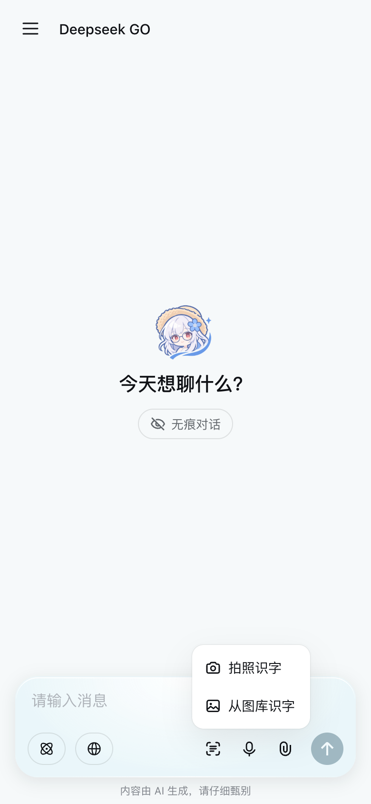
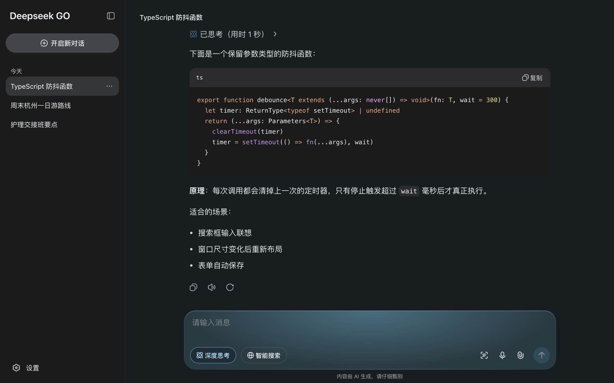

  

<h1 align="center">Deepseek GO</h1>

为 HarmonyOS 打造的 DeepSeek 聊天客户端，支持手机、折叠屏、平板和 2in1

  <a href="https://github.com/APXS114514/DeepSeekGo-Harmony/releases/latest">下载最新版本</a> ·
  <a href="docs/INSTALL.md">安装与构建</a> ·
  <a href="docs/FEATURES.md">功能说明</a> ·
  <a href="docs/CHANGELOG.md">更新日志</a> ·
  <a href="docs/CONTRIBUTING.md">参与改进</a> ·
  <a href="docs/README.en.md">English</a>

Deepseek GO 是一款基于 DeepSeek 官方 Chat Demo 开发的第三方 HarmonyOS 客户端，支持系统语音输入、图片文字识别和系统分享。

使用 ArkTS 和 ArkWeb 把官方开源的 [Chat Demo](https://github.com/deepseek-ai/chat-demo) 包装成原生鸿蒙应用，保留了网页版的流式对话、深度思考、联网搜索和 Markdown 渲染，并加入无痕对话、后台完成通知、跨对话记忆等能力。

应用直接连接 `https://api.deepseek.com`，不经过任何第三方服务器。你需要自备 [DeepSeek 开放平台](https://platform.deepseek.com/api_keys) 的 API Key。

本项目代码基于 MIT 协议开源，但应用图标及欢迎页中的原创角色形象版权归本人所有，不包含在 MIT 授权范围内，使用或分享时须遵循 CC BY-NC-ND 4.0 协议。

## 截图

| 欢迎页 | 深度思考与代码 | 语音输入 |
| :---: | :---: | :---: |
|  |  |  |
| **识别图片文字** | **自定义指令** | **跨对话记忆** |
|  |  |  |

**平板与深色主题**：宽屏时对话历史常驻左侧，可随时收起。

截图为应用内置界面的渲染效果，不含系统状态栏。

## 主要功能

- **对话**：流式回复、深度思考、联网搜索、本机历史搜索、撤回上一轮和对话分支，支持 Markdown、代码、公式、Mermaid 图表及附件。
- **鸿蒙原生能力**：离线语音输入和朗读、图片识字、双向系统分享、聊天记录导出、后台生成与完成通知、系统触感反馈和桌面长按快捷方式。
- **个性化与记忆**：自定义指令和人设卡，跨对话自动记住你的偏好，可随时查看、编辑和清空。
- **多设备**：同一安装包适配手机、折叠屏、平板和 2in1，支持深浅主题、系统字体缩放、返回手势和沉浸光感。
- **隐私**：对话和记忆只存在本机，API Key 保存在系统 Asset Store，应用只与 `api.deepseek.com` 通信。

完整介绍见 [功能说明](docs/FEATURES.md)。

## 下载与安装

需要 HarmonyOS 5.0（API 12）及以上。在 [Releases](https://github.com/APXS114514/DeepSeekGo-Harmony/releases) 下载 `Deepseek-GO-<版本>-unsigned.hap`，这是未签名的安装包，需要用自己的证书签名后安装。也可以从源码构建，用 DevEco Studio 自动签名直接装到手机。步骤见 [安装与构建](docs/INSTALL.md)。

首次打开后，在 **设置 → 数据管理** 填入你的 DeepSeek API Key。

## 未来规划

计划加入桌面服务卡片、多页文档扫描、播控中心后台朗读、跨设备拍照、碰一碰与隔空传送、智感握姿，以及第三方模型 API。详见 [未来规划](docs/ROADMAP.md)。

## 参与改进

欢迎提交 Issue 和 Pull Request，流程见 [参与改进](docs/CONTRIBUTING.md)。架构、验证和打包命令见 [交接文档](docs/HANDOFF.md)，开发与提交规则见 [AGENTS.md](AGENTS.md)。

## 许可证

本项目自有代码和相关文档按 [MIT 许可证](LICENSE) 发布，版权归 APXS 所有。内置前端基于 DeepSeek 官方的 [Chat Demo](https://github.com/deepseek-ai/chat-demo)，上游代码沿用其 [MIT 许可证](chat-demo-main/LICENSE)。分发代码时请保留两份许可证声明。

`assets/images/logo.png`、`assets/images/app-icon.png` 及其在应用和截图中的角色图案由 APXS 创作，采用 **CC BY-NC-ND 4.0**（署名、非商业性使用、禁止演绎）。署名后可以非商业分享原图，改作不可分发。见 [图像授权声明](ARTWORK-NOTICE.txt)。

本项目为个人开发，与深度求索公司没有关联。「DeepSeek」名称及商标归其所有者所有。
