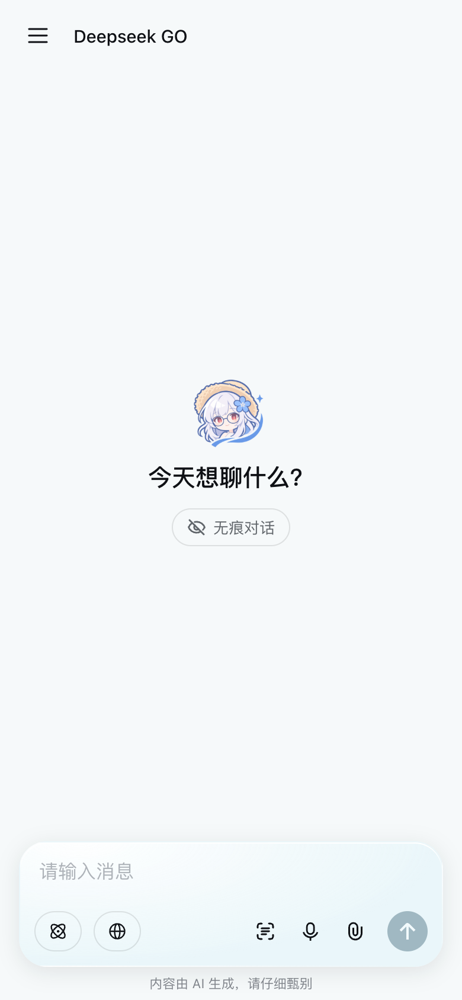
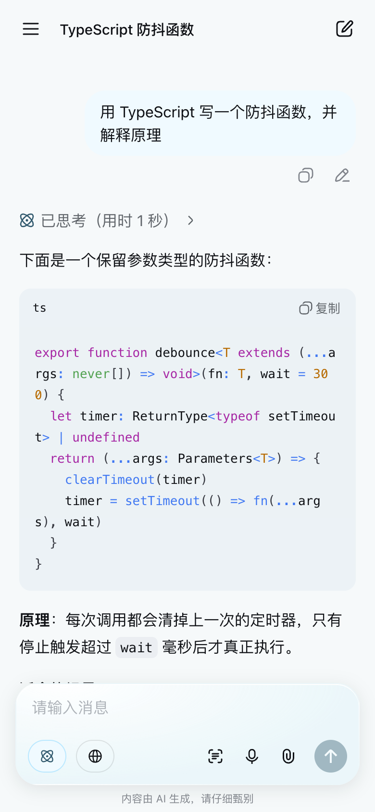
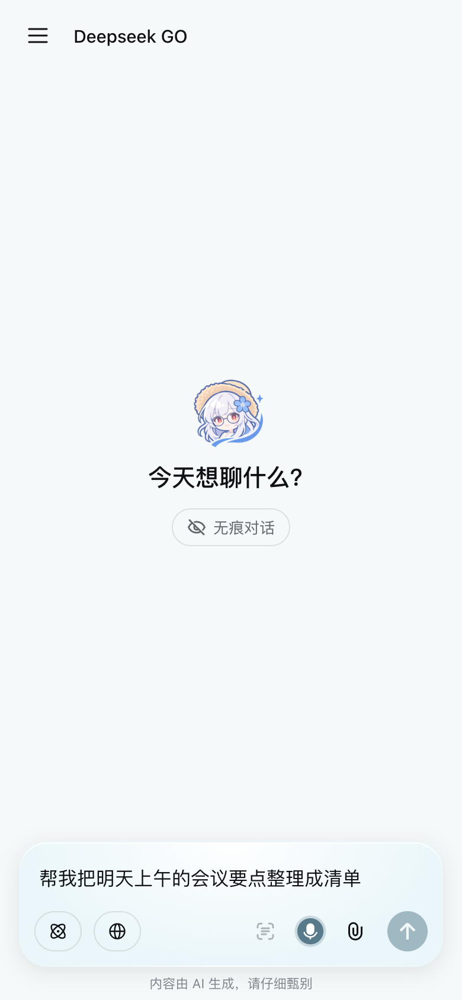
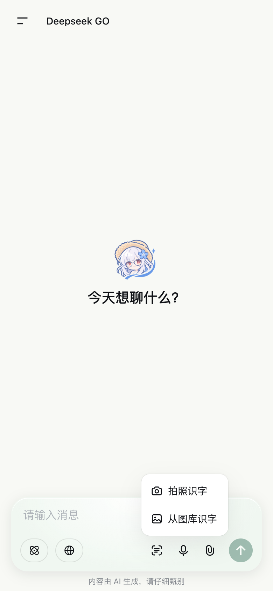
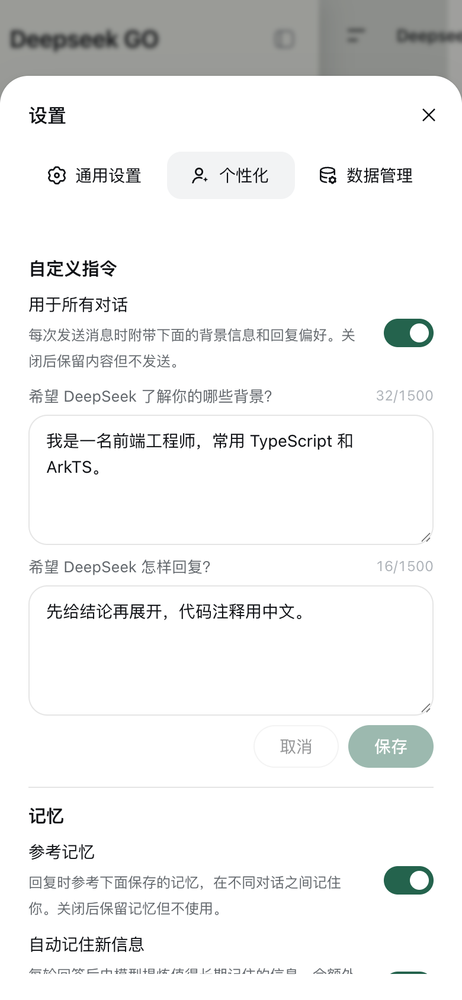
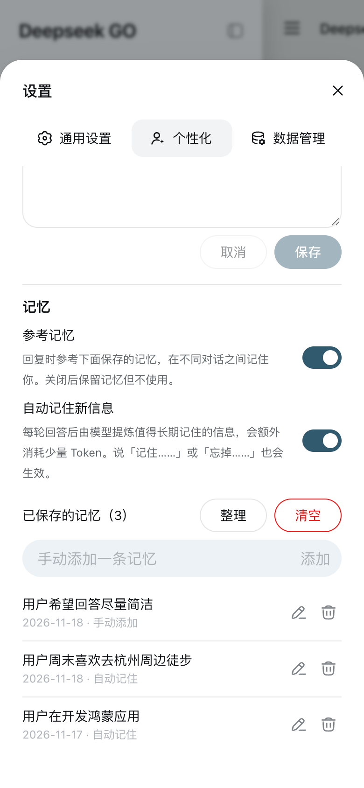

<p align="center">
  
</p>

<h1 align="center">Deepseek GO</h1>

<p align="center">为 HarmonyOS 打造的 DeepSeek 聊天客户端，支持手机、折叠屏、平板和 2in1</p>

<p align="center">
  <a href="https://github.com/APXS114514/DeepSeekGo-Harmony/releases/latest">下载最新版本</a> ·
  <a href="CHANGELOG.md">更新日志</a> ·
  <a href="#从源码构建">从源码构建</a>
</p>

Deepseek GO 是一款基于 DeepSeek 官方 Chat Demo 开发的第三方 HarmonyOS 客户端，适配手机、折叠屏、平板和 2in1，支持系统语音输入、图片文字识别和系统分享。

它用 ArkTS 和 ArkWeb 把 MIT 开源的 [Chat Demo](https://github.com/deepseek-ai/chat-demo) 包装成原生鸿蒙应用，保留了网页版的流式对话、深度思考、联网搜索和 Markdown 渲染，并加入无痕对话、后台完成通知、跨对话记忆等鸿蒙版独有的能力。

应用直接连接 `https://api.deepseek.com`，不经过任何第三方服务器。你需要自备 [DeepSeek 开放平台](https://platform.deepseek.com/api_keys) 的 API Key。

## 截图

| 欢迎页 | 深度思考与代码 | 语音输入 |
| :---: | :---: | :---: |
|  |  |  |
| **识别图片文字** | **自定义指令** | **跨对话记忆** |
|  |  |  |

**平板与深色主题**：宽屏时对话历史常驻左侧，可随时收起。


截图为应用内置界面的渲染效果，不含系统状态栏。

## 功能

### 对话

- 流式回复、多轮对话、编辑历史消息并重新生成，可在不同回答版本之间切换。
- **深度思考**：思考时只预览最新几行，开始回答后自动收起，点标题可展开全文。
- **智能搜索**：联网搜索并标注来源，宽屏时来源卡片在右侧并排显示。
- Markdown、代码高亮、数学公式和 Mermaid 图表，回答可复制或朗读。
- 上传图片、PDF、Office 文档和代码等附件。
- **无痕对话**：在新对话页打开「无痕对话」，对话不保存到历史记录，也不读取或更新记忆，离开后自动丢弃。

### 鸿蒙版独有

- **语音输入**：调用系统离线语音识别，边说边显示文字，停顿后自动结束并填入输入框。不经过 DeepSeek API，也不消耗 Token。
- **识别图片文字**：拍照或从图库选图，在本机识别文字后插入输入框，图片不会上传。
- **分享到 Deepseek GO**：在任意应用中选择「分享 → Deepseek GO」，文字、链接、图片和文档会放进新对话，由你确认后再发送。
- **导出聊天记录**：在 **设置 → 数据管理** 中把全部对话导出为 ZIP，用系统文件管理器选择保存位置，之后可以从同一页面导入。
- **后台生成与完成通知**：切到后台后继续生成回答，完成时发送系统通知，点通知直接回到对应对话。可在 **设置 → 通用设置 → 回答完成通知** 中关闭。
- **API Key 安全存储**：Key 保存在鸿蒙系统的 Asset Store 中，不写入网页存储。

语音和识字依赖设备的系统 AI 能力，设备不支持时对应按钮会自动隐藏。

### 个性化与记忆

在 **设置 → 个性化** 中：

- **自定义指令**：填写「希望 DeepSeek 了解你的哪些背景」和「希望 DeepSeek 怎样回复」，保存后对所有对话生效。
- **跨对话记忆**：每轮回答结束后，模型会从你的话里提炼值得长期记住的信息，例如职业、长期目标和偏好，以后的对话会自然地参考这些信息。在对话中说「记住……」或「忘掉……」同样有效。
- **管理记忆**：可以查看、手动添加、编辑、删除和清空记忆。「整理」会让模型合并重复和过时的条目，不满意可以撤销。
- 指令和记忆各有开关，关闭后内容保留但不再发送。疑似密钥、密码、证件号的内容不会被记住。

自动记忆每轮会额外发送一次很小的请求，消耗少量 Token，不需要时可以在设置里关闭。

### 多设备与界面

- 同一个安装包适配手机、折叠屏、平板和 2in1，布局随窗口宽度变化，跨断点时保留当前会话和草稿。
- 窄屏使用滑动抽屉，宽屏常驻侧栏，收起或展开时聊天区平滑伸缩。
- 背景延伸到状态栏和手势区，内容自动避让状态栏、挖孔和键盘。
- 浅色、深色或跟随系统，主题色可选预设、拾色或输入十六进制颜色。
- 系统返回手势逐级关闭菜单、弹窗、设置、搜索面板和侧栏，没有可关闭的内容时才离开应用。
- 回答、消息和输入框的文字跟随系统字体大小，最大 1.75 倍。
- 2in1 支持快捷键：`Ctrl+N` 新对话、`Ctrl+B` 收起或展开侧栏、`Ctrl+,` 打开设置；右键会话可以重命名或删除。
- **沉浸光感**：输入区的半透明材质和高光，可在 **设置 → 通用设置** 中关闭。
- 动效遵循系统的「减少动态效果」设置。

### 隐私

- 对话、草稿、指令和记忆都只保存在本机。
- 应用只与 `api.deepseek.com` 通信，内置页面使用严格的内容安全策略，外部链接交给系统浏览器打开。
- 代码、安装包和日志中都不包含 API Key。

## 下载与安装

系统要求：HarmonyOS 5.0（API 12）及以上。

在 [Releases](https://github.com/APXS114514/DeepSeekGo-Harmony/releases) 中下载最新的 `Deepseek-GO-<版本>-unsigned.hap`。这是**未签名**的安装包，HarmonyOS 不能直接安装未签名的应用，需要先用自己的证书和 Profile 签名，再通过 `hdc install` 安装。

如果你没有现成的签名环境，从源码构建并用 DevEco Studio 自动签名会更简单：

1. 按下文 [从源码构建](#从源码构建) 生成内置聊天界面。
2. 用 [DevEco Studio](https://developer.huawei.com/consumer/cn/deveco-studio/) 打开 `harmony/`，等待工程同步。
3. 在手机上开启开发者模式和 USB 调试，连接电脑后在 DevEco Studio 中选择这台手机。
4. 打开 **File → Project Structure → Signing Configs**，勾选 **Automatically generate signature**，按提示登录华为开发者账号，然后点 **Run** 安装。参见[华为真机调试说明](https://developer.huawei.com/consumer/cn/doc/harmonyos-faqs/app-debugging-faq-0005/)。

首次打开会进入 **设置 → 数据管理**。填入 API Key 后点 **确定**，应用会先向官方接口校验，再保存到系统安全存储，以后可以在同一页面修改。

## 从源码构建

需要 Node.js 22.12+、pnpm，以及带 HarmonyOS 26.0.0 SDK 的 DevEco Studio。

```sh
cd chat-demo-main
pnpm install --frozen-lockfile
pnpm build:harmony
```

内置聊天界面会生成到 `harmony/entry/src/main/resources/rawfile/chat/`。这个目录不在仓库里，克隆后和修改界面后都要先运行上面的命令，再回到 DevEco Studio 构建。在 `chat-demo-main/` 中运行 `pnpm dev` 可以单独调试网页版。

项目结构：

| 目录 | 内容 |
| --- | --- |
| `harmony/` | ArkTS、ArkUI、ArkWeb 外壳，包括窗口与系统栏、Asset Store、语音、识字、分享和文件保存 |
| `chat-demo-main/` | 内置的聊天前端（React + Rspack），在上游 Chat Demo 的基础上修改 |
| `docs/screenshots/` | README 截图 |

架构、验证和打包命令见 [HANDOFF.md](HANDOFF.md)，开发与提交规则见 [AGENTS.md](AGENTS.md)，每个版本的变化见 [CHANGELOG.md](CHANGELOG.md)。

## 许可证

本项目以 [MIT 许可证](LICENSE) 发布，版权归 APXS 所有，包括作者自绘的 `LOGO.png` 和 `Icon.png`。应用图标上的角色是作者的原创角色。`chat-demo-main/` 基于 DeepSeek 官方的 [Chat Demo](https://github.com/deepseek-ai/chat-demo)，这部分沿用其 [MIT 许可证](chat-demo-main/LICENSE)，版权归 DeepSeek 所有。分发或修改时请同时保留两份许可证声明。

本项目为个人开发，与深度求索公司没有关联。「DeepSeek」名称及商标归其所有者所有。
