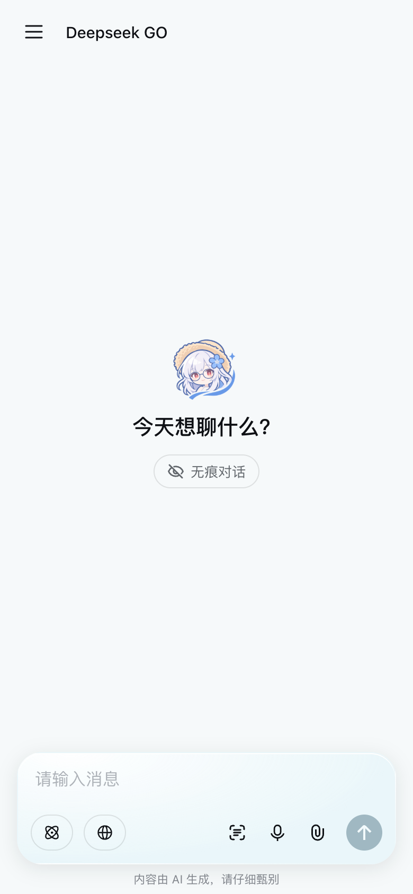
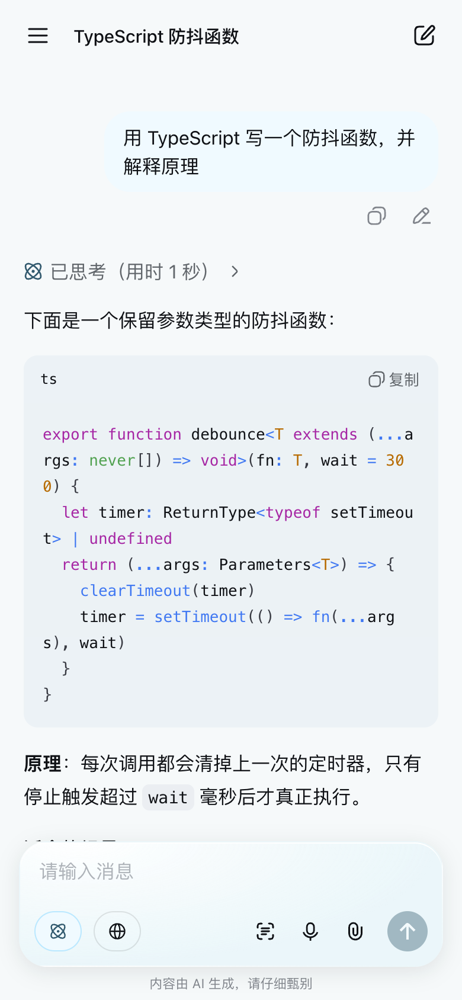
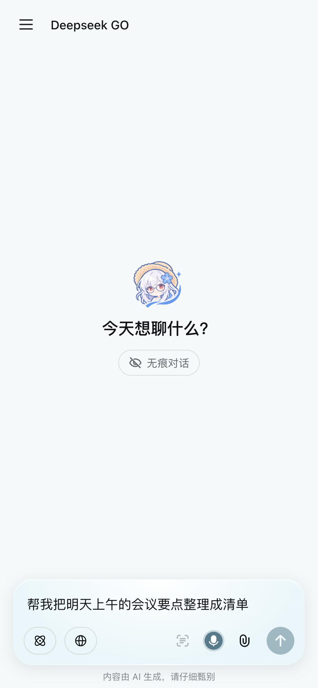
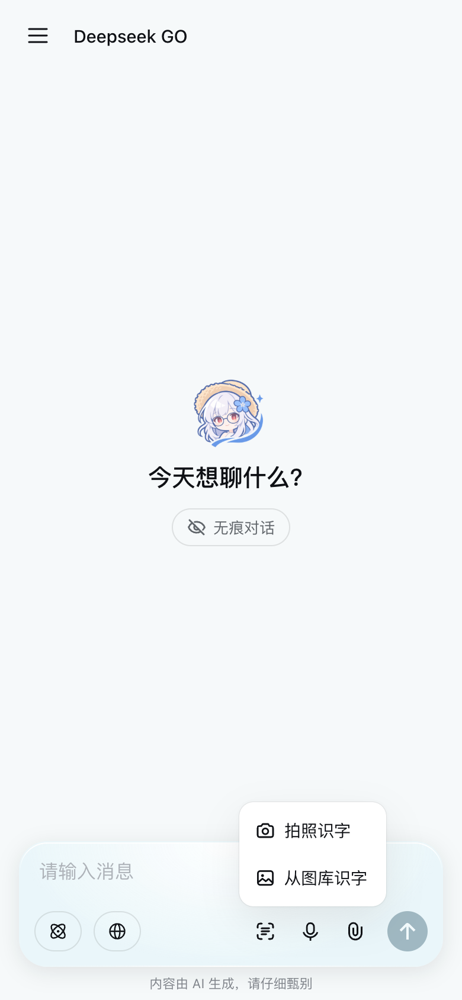
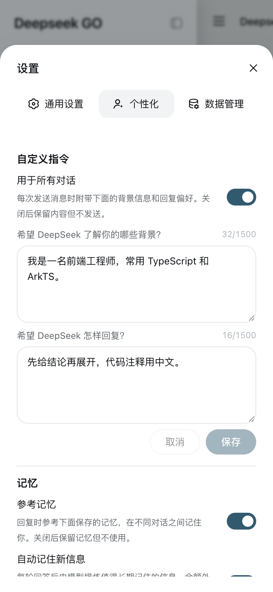
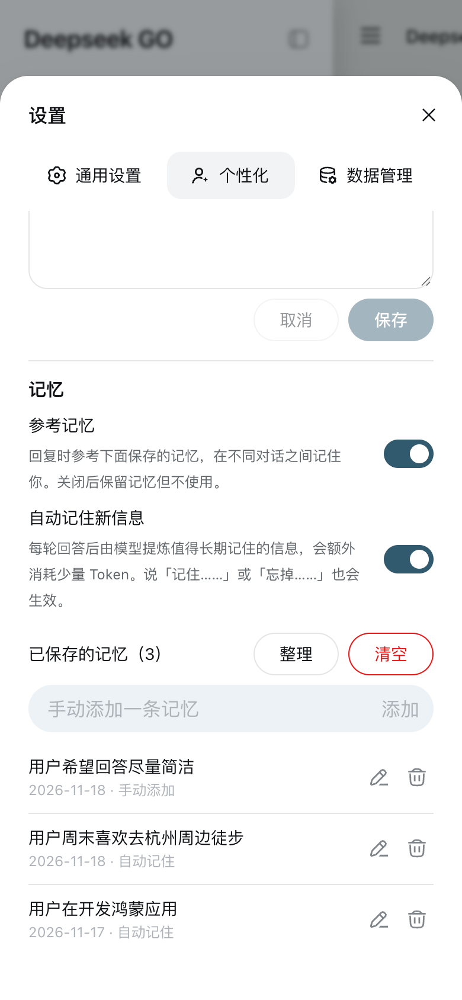
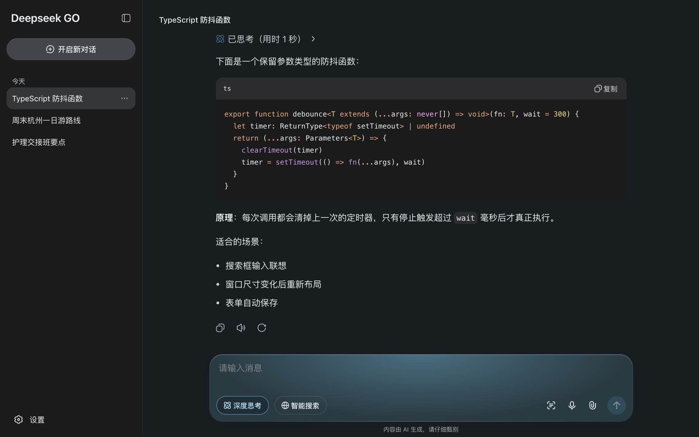

  

<h1 align="center">Deepseek GO</h1>

A DeepSeek chat client for HarmonyOS phones, foldables, tablets, and 2-in-1 devices

  <a href="https://github.com/APXS114514/DeepSeekGo-Harmony/releases/latest">Download the latest release</a> ·
  <a href="INSTALL.en.md">Install and build</a> ·
  <a href="FEATURES.en.md">Features</a> ·
  <a href="CHANGELOG.md">Changelog</a> ·
  <a href="CONTRIBUTING.md">Contribute</a> ·
  <a href="../README.md">简体中文</a>

Deepseek GO is a third-party HarmonyOS client based on DeepSeek’s official Chat Demo. It supports system voice input, image text recognition, and system sharing.

It wraps the official open-source [Chat Demo](https://github.com/deepseek-ai/chat-demo) in a native HarmonyOS app using ArkTS and ArkWeb. It keeps streaming replies, DeepThink, web search, and Markdown rendering from the web demo and adds incognito chats, reply notifications, and memory across chats.

The app connects directly to `https://api.deepseek.com`. You’ll need your own [DeepSeek API key](https://platform.deepseek.com/api_keys).

The project’s code is open source under the MIT License. APXS owns the copyright to the app icon and the original character artwork on the welcome screen. Both are licensed separately under CC BY-NC-ND 4.0, which governs their use and sharing.

## Screenshots

| Welcome screen | DeepThink and code | Voice input |
| :---: | :---: | :---: |
|  |  |  |
| **Image text recognition** | **Custom instructions** | **Memory across chats** |
|  |  |  |

**Tablet and dark mode.** On wider windows, chat history stays in the left sidebar. You can collapse it at any time.

The screenshots show only the bundled app interface.

## Highlights

- **Chat**: streaming replies, DeepThink, web search with sources, Markdown, code, math, and Mermaid diagrams, plus image and document attachments.
- **HarmonyOS features**: offline system voice input, text recognition from photos or the gallery, Share to Deepseek GO, chat export, and background replies with completion notifications.
- **Personalization and memory**: custom instructions and personas, plus memory across chats that you can view, edit, or clear at any time.
- **Every device**: one package for phones, foldables, tablets, and 2-in-1 devices, with light and dark themes, system font scaling, back gestures, and immersive lighting.
- **Privacy**: chats and memories stay on your device, your API key is kept in the system Asset Store, and the app only talks to `api.deepseek.com`.

See [Features](FEATURES.en.md) for the full list.

## Download and install

Requires HarmonyOS 5.0 (API 12) or later. Download `Deepseek-GO-<version>-unsigned.hap` from [Releases](https://github.com/APXS114514/DeepSeekGo-Harmony/releases). The package is unsigned, so sign it with your own certificate before installing it. You can also build from source and let DevEco Studio sign and install it on your phone. See [Install and build](INSTALL.en.md) for the steps.

On first launch, enter your DeepSeek API key in **Settings → Data**.

## Roadmap

Planned next: search past chats, on-device read-aloud, share out, accessibility, a home screen widget, drag and drop, foldable hover mode, and cross-device continuation. See the [Roadmap](ROADMAP.en.md).

## Contribute

Issues and pull requests are welcome. See the [contributing guide](CONTRIBUTING.md) (in Chinese). See [HANDOFF.md](HANDOFF.md) for architecture, verification, and packaging commands, and [AGENTS.md](../AGENTS.md) for development and commit rules.

## License

The project’s original code and documentation are copyright APXS and distributed under the [MIT License](../LICENSE). The bundled frontend is based on [DeepSeek Chat Demo](https://github.com/deepseek-ai/chat-demo), whose upstream code retains its own [MIT License](../chat-demo-main/LICENSE). Keep both license notices when redistributing the code.

APXS created `assets/images/logo.png`, `assets/images/app-icon.png`, and the character artwork reproduced in the app and screenshots. They are licensed under **CC BY-NC-ND 4.0**. You may share the unmodified artwork for noncommercial purposes with attribution. See the [artwork notice](../ARTWORK-NOTICE.txt).

Deepseek GO is an independent project. The DeepSeek name and trademarks belong to their respective owners.
